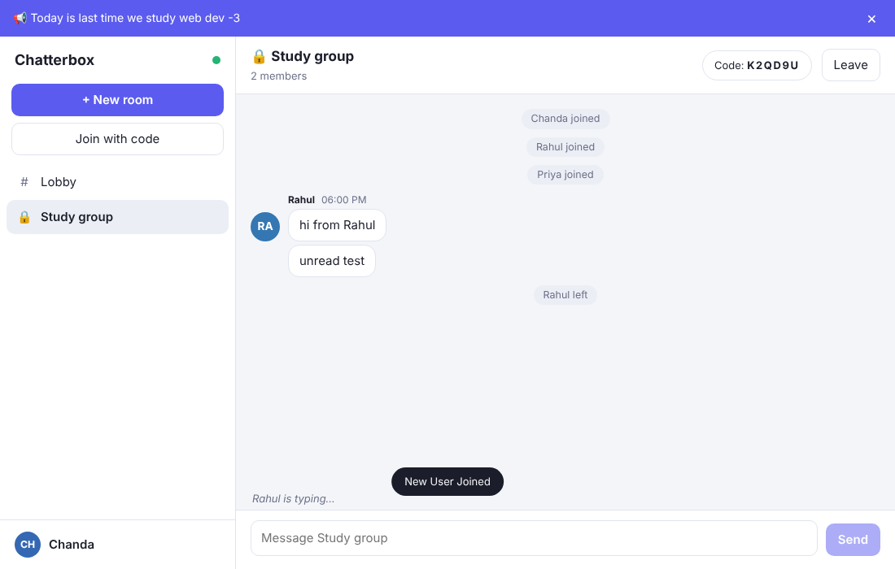
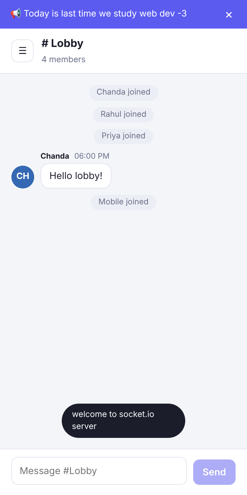

# 💬 Chatterbox – Real-Time Chat App

A real-time chat application built with **Node.js, Express, Socket.IO and React**.
I built the frontend for the chat backend we studied in class, and added my own feature:
**personal rooms** that any number of friends can join using a code.

**Name:** Prabhat Tewatia  
**Roll Number:** 2501730207

| Desktop | Mobile |
|---|---|
|  |  |

---

## ✨ Features

- Pick a display name and start chatting instantly
- **Public Lobby** that everyone joins
- **Personal rooms** – create a room, get a 6-character code, share it, and anyone can join
- Join / leave notices and a live member list
- "Someone is typing…" indicator
- Unread message badges on rooms
- Auto-reconnect – rejoins your rooms if the connection drops
- Works on mobile, with automatic light / dark mode

## 🛠️ Tech Stack

| Part | Technology |
|---|---|
| Backend | Node.js, Express 5, Socket.IO 4 |
| Frontend | React 18, Vite, plain CSS |
| Realtime | WebSockets via `socket.io-client` |

## 🚀 Getting Started

**You need:** [Node.js](https://nodejs.org) 18 or newer.

```bash
# 1. Open a terminal inside the chatapp folder

# 2. Install backend packages
npm install

# 3. Build the React frontend
npm run build

# 4. Start the server
npm start
```

Now open **http://localhost:8080** in two or three browser tabs, use different names, and chat!

### Working on the frontend (hot reload)

```bash
npm start                    # terminal 1 → backend on port 8080
cd client && npm run dev     # terminal 2 → frontend on http://localhost:5173
```


0207) as a class project.
